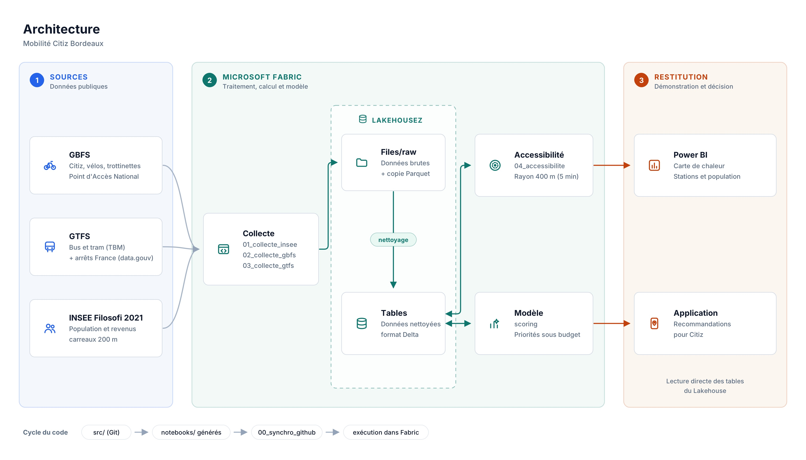

# Architecture technique



## 1. Objectif

L'outil aide Citiz (autopartage) et les collectivités à répondre à deux questions :

- **Qui a accès à une option de mobilité à moins de 5 minutes à pied de chez soi ?**
- **Où ajouter de nouvelles stations pour toucher le plus d'habitants avec un budget donné ?**

La chaîne de traitement va des données publiques brutes jusqu'à une liste d'emplacements classés par priorité, affichée dans Power BI.

## 2. Zone d'étude

Le projet est limité à **Bordeaux Métropole**. La méthode est générique : il suffit de changer la zone dans les paramètres pour l'appliquer à une autre ville.

## 3. Vue d'ensemble

| Bloc | Rôle | Outils |
|---|---|---|
| Sources | Données publiques ouvertes | transport.data.gouv.fr (Point d'Accès National), data.gouv.fr, INSEE |
| Traitement | Collecte, nettoyage, calculs, modèle | Microsoft Fabric (notebooks, Lakehouse) |
| Restitution | Carte, indicateurs, recommandations | Power BI, `app/` |

Dans Fabric, le pipeline est organisé dans le flux de tâches **« Mobilite Citiz Bordeaux »** de l'espace de travail **HackathonZ** :

```
Get data → Store data → Exploratory data analysis → Develop and train models
→ Evaluate and score models → Apply the best model → Expose insight
```

## 4. Sources de données

| Source | Contenu | Format | Notebook |
|---|---|---|---|
| INSEE Filosofi 2021 | Population et revenus par carreau de 200 m | CSV / GeoPackage | `01_collecte_insee` |
| Point d'Accès National (transport.data.gouv.fr) | Stations Citiz, vélos et trottinettes en libre-service | GBFS (JSON) | `02_collecte_gbfs` |
| Point d'Accès National (transport.data.gouv.fr) | Réseaux de bus et tram de Bordeaux / Gironde (TBM) | GTFS (zip de CSV) | `03_collecte_gtfs` |
| data.gouv.fr | Agrégat national des arrêts de transport | CSV | `03_collecte_gtfs` |

OpenStreetMap et l'IGN, cités dans le sujet, ne sont pas collectés : le rayon de 5 minutes est calculé à vol d'oiseau, et la commune de chaque carreau vient du code INSEE (`lcog_geo`).

Le détail des sources, avec liens et licences, est dans [`DATA_SOURCES.md`](../DATA_SOURCES.md). Le détail complet des colonnes est dans [`DONNEES.md`](DONNEES.md).

## 5. Traitement dans Microsoft Fabric

### 5.1 Lakehouse

Tous les notebooks utilisent **LakeHouseZ** comme Lakehouse par défaut.

```
LakeHouseZ
├── Files/
│   └── raw/          données brutes + copie Parquet de chaque table (raw/tables/)
└── Tables/           tables Delta nettoyées, utilisées par les calculs et Power BI
```

- `Files/raw/` garde les fichiers d'origine et une copie Parquet de chaque table, pour relancer les traitements sans tout retélécharger.
- `Tables/` contient les données propres, au format Delta, lisibles directement par Power BI.

### 5.2 Notebooks

| Notebook | Étape du flux | Rôle |
|---|---|---|
| `00_synchro_github` | Get data | Récupère la dernière version du code depuis le dépôt GitHub |
| `01_collecte_insee` | Get data | Population par carreau de 200 m |
| `02_collecte_gbfs` | Get data | Stations Citiz, vélos, trottinettes |
| `03_collecte_gtfs` | Get data | Arrêts de bus et tram |
| `04_accessibilite` | Exploratory data analysis | Options de mobilité à 5 min à pied, population desservie |
| `scoring` | Evaluate and score models | Score des emplacements candidats |

### 5.3 Calcul de l'accessibilité

- Une station est considérée comme accessible si elle est à **moins de 5 minutes à pied**, soit un **rayon de 400 m à vol d'oiseau** autour du centre du carreau.
- Pour chaque carreau de 200 m, on calcule le **nombre d'options de mobilité accessibles par habitant**.
- Pour chaque station, on calcule la **population desservie** dans son rayon de 5 minutes.

### 5.4 Modèle et recommandations

1. **Prédiction** : le modèle attribue un score à chaque emplacement candidat à partir des caractéristiques du quartier (population, revenus, offre de transport existante).
2. **Coût** : un coût estimé est associé à chaque type d'équipement.
3. **Optimisation** : on sélectionne les emplacements qui maximisent la population nouvellement desservie sous contrainte de budget, sans compter deux fois les habitants déjà couverts.

Méthode d'évaluation et métriques : à compléter.

## 6. Restitution

Le rapport Power BI (étape **Expose insight**) se connecte directement aux tables de LakeHouseZ :

1. **Carte de chaleur** : accès à la mobilité par carreau.
2. **Stations** : stations existantes par type, avec la population desservie.
3. **Recommandations** : emplacements proposés, coût, habitants nouvellement desservis.

## 7. Tables du Lakehouse

Toutes les tables sont dans `LakeHouseZ / Tables / dbo`. Elles ont toutes une colonne `date_collecte` (UTC), et les coordonnées sont en WGS84.

### `01_collecte_insee`

| Table | Contenu | Colonnes principales |
|---|---|---|
| `insee_carreaux_200m` | Population et revenus par carreau | `idcar_200m`, `lcog_geo` (code commune), `ind` (habitants), `men`, `men_pauv`, `men_prop`, `men_coll`, `ind_*` (tranches d'âge), `i_est_200` (carreau imputé, masqué), `lon` / `lat` (centre) |

### `02_collecte_gbfs`

| Table | Contenu | Colonnes principales |
|---|---|---|
| `gbfs_flux` | Catalogue des flux et statut de collecte | `jeu_titre`, `producteur`, `est_citiz`, `licence`, `statut`, `nb_stations` |
| `gbfs_stations` | Stations fixes | `station_id`, `nom`, `systeme_nom`, `operateur`, `est_citiz`, `types_vehicules`, `lat` / `lon`, `capacite` |
| `gbfs_types_vehicules` | Types de véhicules par système | `vehicle_type_id`, `form_factor`, `propulsion_type` |
| `gbfs_etat_stations` | Historique de disponibilité (une photo par exécution) | `station_id`, `vehicules_disponibles`, `places_disponibles`, `date_collecte` |
| `gbfs_vehicules` | Historique des véhicules | `vehicule_id`, `station_id` ou `lat` / `lon`, `est_reserve`, `date_collecte` |

### `03_collecte_gtfs`

| Table | Contenu | Colonnes principales |
|---|---|---|
| `gtfs_catalogue` | GTFS publiés en France | `jeu_titre`, `producteur`, `licence`, `modes`, `url` |
| `gtfs_arrets_france` | Tous les arrêts de France | `stop_id`, `stop_name`, `stop_lat` / `stop_lon`, `dataset_organisation`, `licence_reseau` |
| `gtfs_ressources` | Statut de lecture de chaque réseau de la zone | `statut`, `fichiers`, `nb_arrets` |
| `gtfs_agency`, `gtfs_routes`, `gtfs_stops`, `gtfs_trips`, `gtfs_calendar`, `gtfs_calendar_dates`, `gtfs_stop_times` | GTFS complets de Bordeaux / Gironde | Colonnes standard GTFS (`route_type` : tram, bus…), plus `ressource_id` et `jeu_titre` |

### `04_accessibilite` et `scoring`

À compléter.

### Vue pour Power BI

| Vue | Contenu |
|---|---|
| `v_stations_bordeaux` | Stations GBFS de Bordeaux, dernière collecte uniquement, avec une colonne `categorie` (Autopartage Citiz, Vélo en station TBM, Vélo / trottinette en libre-service) |

## 8. Organisation du dépôt

```
.
├── DATA_SOURCES.md     liste des sources de données
├── README.md           présentation et lancement du projet
├── requirements.txt    dépendances Python
├── src/                code source (collecte, calculs, modèle)
├── notebooks/          notebooks générés depuis src/
├── app/                interface de démonstration
├── data/               petits fichiers d'exemple
├── docs/               documentation technique
├── fabric/             éléments synchronisés depuis Fabric
└── slides/             présentation
```

## 9. Workflow de développement

- Le code est écrit dans `src/`, puis les notebooks sont générés et synchronisés dans Fabric avec `00_synchro_github`.
- Les notebooks ne sont **pas modifiés directement dans Fabric** : on les y exécute seulement.
- Chaque membre travaille sur une branche `feature/...`, puis ouvre une Pull Request vers `dev`.
- `dev` est fusionnée dans `main` pour la version finale.

```
feature/...  →  dev  →  main
```

## 10. Reproduire le projet

1. Créer un espace de travail Fabric avec une capacité active.
2. Créer un Lakehouse.
3. Importer les notebooks et les rattacher au Lakehouse (Explorateur → Ajouter des éléments de données → Catalogue OneLake).
4. Exécuter dans l'ordre : `00_synchro_github`, `01_collecte_insee`, `02_collecte_gbfs`, `03_collecte_gtfs`, `04_accessibilite`, `scoring`.
5. Ouvrir le rapport Power BI connecté au Lakehouse.

## 11. Choix techniques

| Choix | Raison |
|---|---|
| Microsoft Fabric | Calcul dans le cloud, stockage partagé, Power BI intégré |
| Lakehouse + Delta | Un seul point de stockage pour tous les notebooks et pour Power BI |
| Flux de tâches Fabric | Pipeline lisible, chaque notebook rattaché à son étape |
| Code dans `src/`, synchronisé depuis GitHub | Code versionné proprement, notebooks toujours à jour |
| Carreaux INSEE 200 m | Maille fine, adaptée à une distance de 5 min à pied |
| Rayon à vol d'oiseau | Simple et rapide à calculer sur toute la zone ; le réseau piéton est une amélioration possible |
| Restriction à Bordeaux Métropole | Volumes maîtrisés, résultats vérifiables, méthode réutilisable |

## 12. Limites et points d'attention

- **Distances** : le rayon de 400 m à vol d'oiseau surestime l'accessibilité (rivières, voies ferrées, impasses) ; un calcul sur le réseau piéton OpenStreetMap serait plus réaliste.
- **Données temps réel** : les flux GBFS donnent l'état à un instant donné ; l'usage réel des stations n'est pas publié.
- **Coûts** : les coûts par équipement sont des estimations.
- **Libre-service** : pour Dott et Pony, les « stations » GBFS sont des véhicules ou zones de dépôt, et leur position change en permanence.
- **Vie privée** : les carreaux INSEE imputés (`i_est_200`) sont masqués, pour ne pas exposer de petits groupes d'habitants.
- **Équité** : le classement doit tenir compte des zones peu desservies, et pas seulement des quartiers déjà bien équipés.